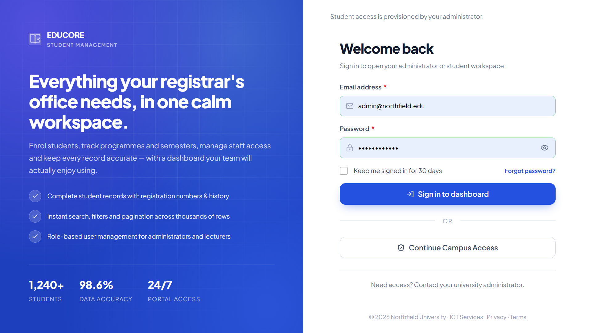
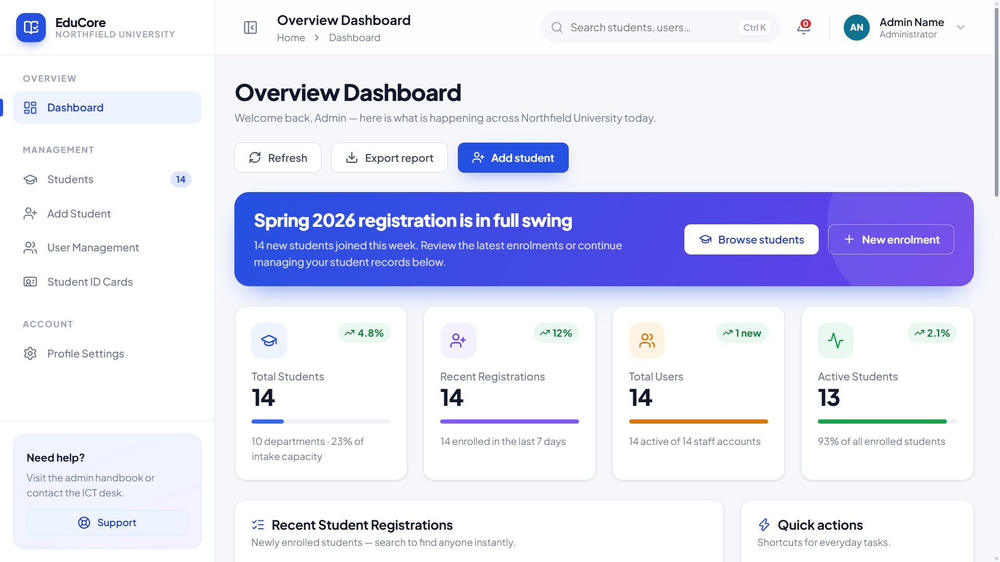
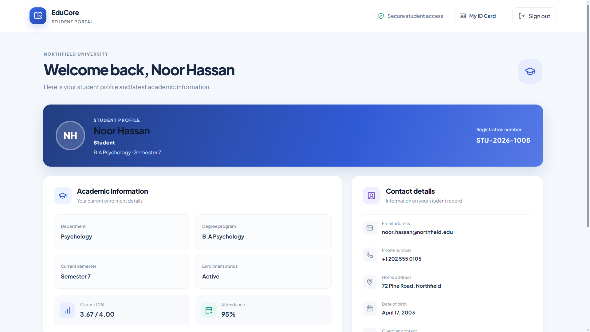

# EduCore Student Management System

EduCore is a PHP and MySQL student management application with separate Admin and Student experiences. Administrators manage student records and accounts; students sign in to a private dashboard that shows their own academic information. The project also includes digital student ID cards with QR verification.

## Technologies used

- **Frontend:** HTML5, CSS3, and vanilla JavaScript.
- **Backend:** PHP 8.1+ with PDO and prepared MySQL queries.
- **Database:** MySQL or MariaDB.
- **Local web server:** Apache through XAMPP.
- **Browser libraries and assets:** Lucide icons, qrcode-generator 2.0.4, jsPDF 4.2.1, html2canvas 1.4.1, and Google Fonts.

## Features

- **Admin dashboard:** manage student records, view and edit student details, manage user accounts, and review dashboard summaries.
- **Linked student accounts:** adding a student also creates a login account; editing a student's name or email updates the linked account.
- **Student dashboard:** each student can view their own profile, registration number, department, program, semester, contact details, and academic information, along with relevant courses.
- **Role-based access:** Admins use the existing Admin Dashboard. Students can access only their own student information and student-facing features.
- **Digital student ID cards:** Admins can generate, regenerate, revoke, and print student cards. Students can view only their own card.
- **QR verification:** each card has a unique QR code. The public verification page shows limited identity information and card status.
- **PDF download:** Download PDF saves a file containing the front and back of the card. Print card opens the browser print dialog.
- **Responsive layout:** the Admin and Student pages adapt to desktop and mobile screens.

## Screenshots

### Login Page


### Admin Dashboard


### Student Dashboard


## Requirements

- Windows with [XAMPP](https://www.apachefriends.org/) or an equivalent Apache/PHP/MySQL setup.
- PHP 8.1 or later, with `pdo_mysql`, `mbstring`, and OpenSSL enabled.
- MySQL or MariaDB.
- Internet access in the browser for the hosted fonts, icons, QR encoder, and pinned PDF-generation libraries.

## Install and run with XAMPP

1. Copy the project folder into `C:\xampp\htdocs` and name it `Student Management System` (or use your chosen folder name).
2. Open the XAMPP Control Panel and start **Apache** and **MySQL**.
3. Open `http://localhost/phpmyadmin`.
4. For a **new installation**, use phpMyAdmin’s **Import** tab to import `database/schema.sql`. This creates the `student_management_system` database and its application tables.
5. Open PowerShell in the project folder and load demo accounts and sample data:

   ```powershell
   C:\xampp\php\php.exe database\seed_demo.php
   ```

6. For student ID card support, import `database/student_id_cards.sql` into the `student_management_system` database once, then create the private QR encryption key:

   ```powershell
   C:\xampp\php\php.exe database\setup_student_id_cards.php
   ```

7. Visit `http://localhost/Student%20Management%20System/` and sign in.

Do not open the PHP pages directly from File Explorer. They need to be served by Apache.

### Existing database

Back up your existing database before applying migrations. Do not re-import `database/schema.sql` into an already migrated installation.

- If the database predates the student portal role and login links, import `database/migrate_student_dashboard.sql`, then import `database/student_courses.sql` if the course table is not already installed. Run `database/seed_demo.php` afterward to add the demo records and courses.
- If the student role and account-link migration is already installed but courses are missing, import `database/student_courses.sql` and run `database/seed_demo.php`.
- Import `database/student_id_cards.sql` once to add ID card storage. It creates a separate table linked to the existing students; it does not replace student records.
- Run `database/setup_student_id_cards.php` once to create `config/student_id_card.key`. Keep this key private and include it in secure backups. Existing QR cards cannot be displayed if the key is lost.

Skip any migration that has already been applied. The demo seed adds sample data; do not run it on a production database unless you want those demo records.

## Demo sign-ins

Use these local demo accounts after running `database/seed_demo.php`:

| Role | Email | Password |
|---|---|---|
| Admin | `admin@northfield.edu` | `adminpass123` |
| Student | `aisha.rahman@northfield.edu` | `DemoPass123!` |
| Student | `daniel.kim@northfield.edu` | `DemoPass123!` |

These credentials are for local demonstration only. The seed script does not reset existing accounts when run again. If you need to create a different Admin account from the terminal, run:

```powershell
C:\xampp\php\php.exe database\create_admin.php "Campus Administrator" admin@example.com
```

The script prompts for the password.
## Database configuration

By default, the app connects to MySQL at `127.0.0.1:3306` using database `student_management_system`, user `root`, and an empty password. You can override these settings with environment variables:

- `SMS_DB_HOST`
- `SMS_DB_PORT`
- `SMS_DB_NAME`
- `SMS_DB_USER`
- `SMS_DB_PASSWORD`
- `SMS_ID_CARD_KEY` (optional; 64 hexadecimal characters)

## Project structure

| Path | Purpose |
|---|---|
| `index.php` | Login page |
| `pages/` | Admin, Student, card, and verification pages |
| `api/`, `auth/`, `students/`, `users/` | PHP request handlers and database operations |
| `config/` | Database connection and ID card token security |
| `database/` | Schema, migrations, demo seed, and ID card setup |
| `css/`, `js/`, `assets/`, `images/` | UI styles, browser behavior, and visual assets |

For additional backend details, see [`README-backend.md`](README-backend.md).
